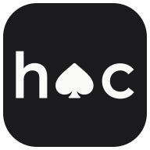

<p align="center">
  
</p>

<h1 align="center">House of Cards</h1>

<p align="center">
  <strong>See which companies you really own through your ETFs — and what happens to your money when one industry, country, or supplier fails.</strong>
</p>

<p align="center">
  <a href="https://house-of-cards-pink.vercel.app/"><strong>Live demo → house-of-cards-pink.vercel.app</strong></a>
  &nbsp;·&nbsp;
  <a href="docs/hoc/DEMO.md">3-minute walkthrough</a>
  &nbsp;·&nbsp;
  <a href="docs/hoc/CONTRACT.md">API &amp; Contract</a>
  &nbsp;·&nbsp;
  <a href="docs/hoc/EVAL.md">Gold Benchmark</a>
</p>

> **Note:** House of Cards is a proof of concept, not investment advice, and it does not trade or execute orders.

---

## What it does

Switch between **Simple view** (plain-English walkthrough + a 5-step guided flow at `#/guide`) and **Full view** (the complete analyst dashboard) at any time from the top bar while keeping your portfolio:

- **Portfolio (`#/portfolio`):** Enter your ETFs by **share count** (valued at latest exchange closes from TickerInside, e.g. `5 IVV / 4 QQQ / 9 XLK / 34 EEM = $9,817.68`) or by **percentage** (`%`, with optional pinned rows), or load a verified sample portfolio in one click.
- **Exposures (`#/exposures`):** Look through every ETF's real, published holdings to see your effective ownership in each underlying company (merging share classes like `GOOG` + `GOOGL` and cross-listings like `TSM` + `2330.TW`), with a searchable holdings table and money-flow breakdown.
- **Overlap (`#/overlap`):** Inspect the pairwise weighted overlap heatmap across your ETFs (e.g. `QQQ` and `XLK` share `50.11%` by weight across `35` companies) and drill into the shared holdings behind any pair.
- **Dependencies (`#/dependencies`):** **Find dependencies** reads the latest SEC `10-K` / `20-F` annual reports for your top holdings using Gemini Flash sub-agents, keeping **only word-for-word verified filing quotes** in Python. Scores relationship importance (`critical` / `high` / `medium` / `low`), runs context checks (`V-INT`), highlights single points of failure (e.g. `12.39%` of the sample portfolio depends on **TSMC**), and lets you run **Go deeper** multi-step agentic filing research.
- **Compare / Try a change + Failure simulator (`#/compare`):** Edit a candidate mix side by side with your current portfolio or apply one-click **Change ideas** (rules + Python-verified Argon AI proposals) to see instant before/after concentration and dependency deltas — plus the **Failure simulator** (*"What if one part fails?"*), showing before → after dollars under historical worst-month proxy ETF drops or a simulated `20%` fall.
- **Risk (`#/risk`):** Check top-5 / top-10 concentration, effective equal-sized company count (`1 / HHI`), industry and country breakdowns with direct *"What if it fails?"* stress links, per-fund disclosure dates, and 5-bucket data coverage.

---

## Quick start / Setup

### Prerequisites

- **Python 3.12+** managed with [**uv**](https://docs.astral.sh/uv/) (`winget install astral-sh.uv` on Windows; `brew install uv` on macOS)
- **Node.js 22.12+** and **npm**

### 1. Start the backend (`http://127.0.0.1:8000`)

```bash
cd backend
uv sync
```

Create `backend/.env` (or copy [`backend/.env.example`](backend/.env.example)) with **placeholder values replaced by your own** (never commit real keys or personal emails):

```dotenv
# Needed for live SEC EDGAR 10-K / 20-F / N-PORT requests (SEC requires "Name email@domain.com")
HOC_SEC_CONTACT="Your Name you@example.com"

# Secret — needed only for uncached live Gemini extraction/synthesis; sent only in a request header
GEMINI_API_KEY=your-gemini-api-key-here
```

Run the API server:

```bash
uv run uvicorn hoc.api.app:app --host 127.0.0.1 --port 8000
```

### 2. Start the frontend (`http://127.0.0.1:5173`)

In a second terminal:

```bash
cd frontend
npm ci
npm run dev
```

Open **http://127.0.0.1:5173** — the Vite dev server proxies `/api/*` requests to `http://127.0.0.1:8000`.

### 3. Offline mode, CLI & tests

The backend warms its local disk cache (`backend/.cache/`) on startup. Without `GEMINI_API_KEY` or `HOC_SEC_CONTACT`, cached portfolios and dependency scans still work cleanly and uncached scans report which setting is missing.

```bash
# Serve strictly from local cache with zero network calls
cd backend && HOC_OFFLINE=1 uv run uvicorn hoc.api.app:app --host 127.0.0.1 --port 8000

# Pre-warm the cache or run portfolio analysis from the CLI
cd backend && uv run python -m hoc.cli warm
cd backend && uv run python -m hoc.cli analyse --example us-core-tilt

# Run backend unit & contract test suite (network blocked in tests)
cd backend && uv run pytest

# Run standalone stdlib evaluation & validation suites
cd backend && uv run hoc eval
python validation/run_validation.py
python validation/stress/run_stress_validation.py

# Run frontend unit tests and production type-check + build
cd frontend && node --test app/ui/*.test.mjs app/pages/**/*.test.mjs app/*.test.mjs
cd frontend && npm run build
```

---

## How it works

Every portfolio figure, company match, and dollar loss is computed by **deterministic Python** on the backend. Gemini is used only to propose candidate dependency quotes from SEC filings, judge ambiguous filing context, summarize Python-computed metrics via `{{metric:id}}` placeholders, and suggest candidate ETF swaps — and Python verifies every quote and number before anything reaches the UI.

```text
 ETF tickers ──> Holdings adapters ──> Look-through & identity ──> Portfolio analysis ──> SEC 10-K / 20-F AI scan ──> Python verifier
 (shares / %)    (TickerInside,        (CIK, LEI, ISIN, 48         (exposure, overlap,    (Gemini Flash extract +     (verbatim quote check,
                  iShares, N-PORT)      curated aliases)            sectors, HHI, stress)  light research agents)      V-INT, R-IMP, metrics)
```

For the full mathematical specification, API schemas, and error codes, see [`docs/hoc/CONTRACT.md`](docs/hoc/CONTRACT.md) and [`docs/hoc/HISTORY.md`](docs/hoc/HISTORY.md).

<details>
<summary><strong>Version history (v1–v3.1), verification pipeline &amp; gold benchmark details</strong></summary>

- **v1 — Look-through & overlap:** Multi-source ETF ingestion (`TickerInside` primary, `iShares` CSV fallback, `SEC N-PORT` fallback), un-rescaled look-through exposure, share-class & cross-listing identity resolution, pairwise weighted overlap, and `HHI` concentration.
- **v2 — Shares valuation & SEC filing dependencies:** Exchange-close share valuation (`POST /api/valuation`), SEC `10-K`/`20-F` ingestion + reverse EDGAR search, per-company Gemini Flash extraction, word-for-word quote verification (`verify_quote`), target-local `sole_source` grounding (`FIX-34`), and placeholder-checked Argon synthesis.
- **v3 / v3.1 — Interpretation checks (`V-INT`), importance scoring (`R-IMP`), coverage (`C-COV`), agentic research (`A-RES`), Compare & Failure simulator (`FIX-63`):**
  - **Held-out Gold Benchmark ([`docs/hoc/EVAL.md`](docs/hoc/EVAL.md)):** Tested on **10 unseen non-tech SEC 10-K filings** (`NKE, F, GM, BA, SWKS, QRVO, GLW, PFE, DE, SBUX`, zero tuning) against a 2-annotator + lead-adjudicated key (`222` relationships, `115` core, `79` hard negatives):
    - **Precision:** **88.4%** `[83.2%, 92.5%]` blind (`114/129`) · **96.1%** `[89.6%, 100.0%]` after reviewing unmatched verbatim quotes (`124/129`)
    - **Core recall:** **57.4%** `[35.3%, 76.0%]` (`66/115`)
    - **Hard negatives wrongly kept:** **1.3%** (`1/79`)
    - **Direction & factory-country accuracy:** **100.0%** (`124/124` direction, `39/39` facility country)
    - **Importance agreement (quadratic weighted $\kappa$):** **0.475** `[0.382, 0.631]`
  - Full details in [`docs/hoc/HISTORY.md`](docs/hoc/HISTORY.md) and [`docs/hoc/EVAL.md`](docs/hoc/EVAL.md).

</details>

---

## Failure simulator

On the **Compare / Try a change** screen (`POST /api/stress`), the failure simulator answers *"If one industry, country, or supplier fails, what happens to my money?"* Pick an **Industry**, **Country**, or **Supplier** to compare before → after money for **Your portfolio** and **Your new mix** on the same dollar starting value (your shares-mode valuation total, or a notional `$10,000` in `%` mode), how much less the new mix loses, the shock basis, and the top affected companies:

- **Historical vs. simulated drops:** When a proxy ETF has price history, the drop is **historical** — the proxy ETF's worst 1-month (**21-trading-day**) fall over the last **5 years** of daily adjusted closes from the Yahoo Finance v8 chart API (e.g. `XLK` `−19.37%` from `2026-10-07` to `2026-11-05` for Information Technology, `EWT` `−26.12%` for Taiwan, `SPY` `−12.80%` for the US; full proxy map in [`docs/hoc/CONTRACT.md`](docs/hoc/CONTRACT.md) §11, demo scenario table in [`docs/hoc/demo/failure-simulator.md`](docs/hoc/demo/failure-simulator.md), and standalone stdlib verification in [`validation/stress/`](validation/stress/)). When no proxy history is available, it falls back to a **simulated 20% fall** (`DEFAULT_SHOCK_DROP = 0.20`) and states why. **Supplier** shocks always use a simulated 20% fall across the supplier (if held) and the portfolio companies that rely on it in the verified dependency scan.
- **Known limits:** Country codes come from TickerInside's per-stock files and US-exchange ordinary listings (`FIX-67`, while foreign ADRs and unmapped listings remain unknown and are reported on screen). For industry shocks, `affected_weight` and `loss_fraction` use the portfolio's `analysis.sectors` totals (which come from the funds' own published breakdowns when line-level company sectors are incomplete), while the expandable company list shows the individual holdings we can name.

---

## Data sources & licences

| Source | Used for | Licence & notes |
|---|---|---|
| [TickerInside](https://tickerinside.com/api/) | Primary ETF holdings, company names, exchange closes, CIK/FIGI identifiers | **CC BY 4.0.** Citation for each fund is displayed in the app. Republishes daily issuer files or quarterly SEC N-PORT filings. |
| [iShares](https://www.ishares.com) holdings CSV | Fallback for iShares funds, including GICS sectors | Fetched at runtime and cached locally; never redistributed. |
| [SEC EDGAR N-PORT](https://www.sec.gov/edgar) | Fallback holdings + ISIN and LEI identifiers | **Public domain.** Quarterly, published ~60 days after quarter end. |
| SEC EDGAR 10-K / 20-F & full-text search | Dependencies: suppliers, customers, facilities | **Public domain.** Requires `HOC_SEC_CONTACT`; rate-limited to $\le 10$ req/s. |
| Yahoo Finance v8 chart API | 5-year daily adjusted closes for sector/country proxy ETFs (`POST /api/stress`) | Fetched via 24h local cache; falls back to simulated `20%` drop when offline or unavailable. |
| Google Gemini API | Dependencies extraction (`Flash`), context judge, synthesis (`Argon`), change ideas | Requires `GEMINI_API_KEY`. Every quote and metric placeholder is verified in Python before display. |

No proprietary financial data is committed to this repository; the only committed fixtures are synthetic test cases (`backend/tests/fixtures/synthetic/`, `frontend/api/__fixtures__/`).

---

## Known limits

- **Holdings freshness:** Holdings are only as fresh as each fund's latest published disclosure (daily for issuer-backed funds; up to ~60 days after quarter end for N-PORT-only funds like `QQQ`).
- **Identity resolution:** Merges share classes through SEC `CIK`/`LEI` and a curated list of 48 cross-listing aliases (`TSM` ↔ `2330.TW`, Samsung common/preferred, Shell, Unilever). Cross-listings outside that list remain separate.
- **Company sectors:** Come from TickerInside's per-stock files for each fund's heaviest ~150 holdings; non-US local listings without a per-stock file show as `Unknown` at the company level while portfolio-level sector totals use each fund's reported breakdown.
- **Dependencies only see what companies disclose:** Big customers are often anonymous in filings (*"one customer accounted for 22% of revenue"* → flagged under `unnamed_customers`), annual reports can be up to a year old (`old_filings`), and broad macro-region facilities (*"Asia"*) remain unplaced (`region_only_facilities`) rather than assigned to a guessed country.
- **Cold dependency scan latency:** An uncached **Find dependencies** run reads ~15 annual reports and takes ~1–2 minutes; cached runs return immediately.
- **Exchange-close share valuation:** Share prices are exchange closes (not intraday NAV), and only USD-priced ETFs can be valued by shares; non-USD funds can be pinned to a `%` in Full view.
- **Not investment advice:** Local / demo proof of concept with no user accounts, no order execution, and no investment recommendations.

---

## Repository layout

| Path | Description |
|---|---|
| [`backend/`](backend/README.md) | FastAPI service (`hoc`): source adapters, normalisation, identity, portfolio & stress maths, SEC filing verifier, AI & research pipeline, CLI, and eval harness |
| [`frontend/`](frontend/README.md) | React + TypeScript + Vite UI (Simple walkthrough, 5-step Guide, and Full analyst view) |
| [`docs/hoc/`](docs/hoc/) | Architecture contract ([`CONTRACT.md`](docs/hoc/CONTRACT.md)), walkthrough ([`DEMO.md`](docs/hoc/DEMO.md)), failure-simulator demo table ([`demo/failure-simulator.md`](docs/hoc/demo/failure-simulator.md)), benchmark ([`EVAL.md`](docs/hoc/EVAL.md)), and version history ([`HISTORY.md`](docs/hoc/HISTORY.md)) |
| [`validation/`](validation/) | Standalone standard-library verification scripts (ETF overlap, residual return co-movement, and 5-year proxy ETF drawdowns in [`validation/stress/`](validation/stress/)) |
| [`scripts/`](scripts/) | Live API smoke checks ([`smoke_api.py`](scripts/smoke_api.py)) and TickerInside cross-checks |
| [`tools/board`](docs/AGENT_BOARD.md) | GitHub-issue message board CLI used by the human + multi-agent team |
