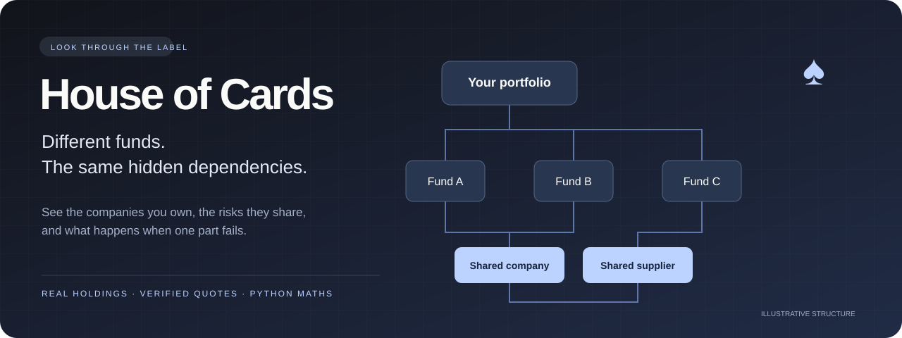
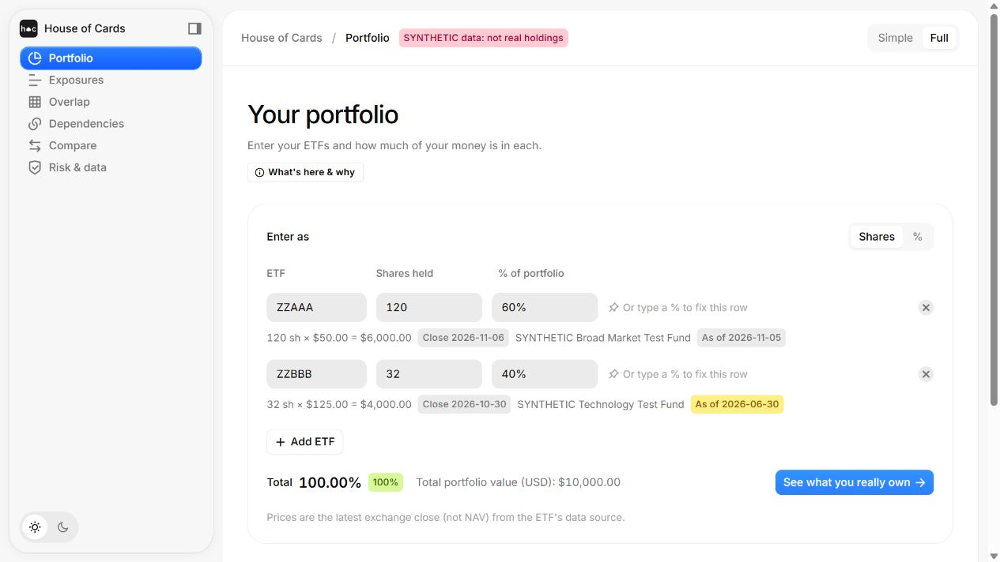
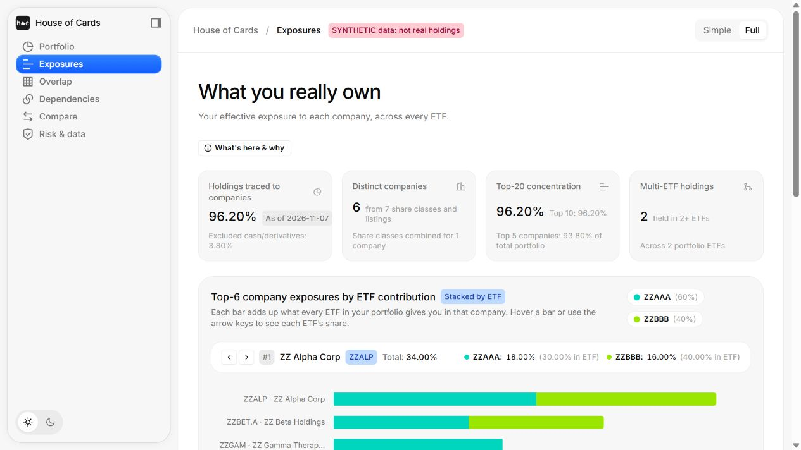
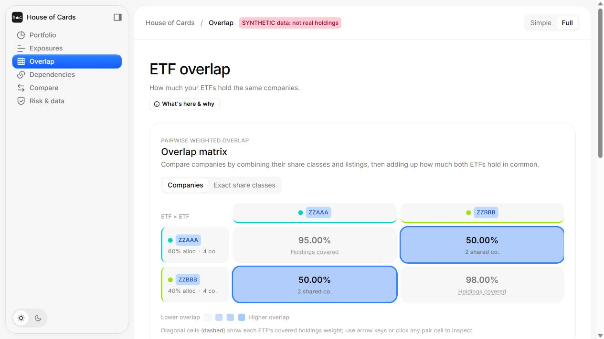
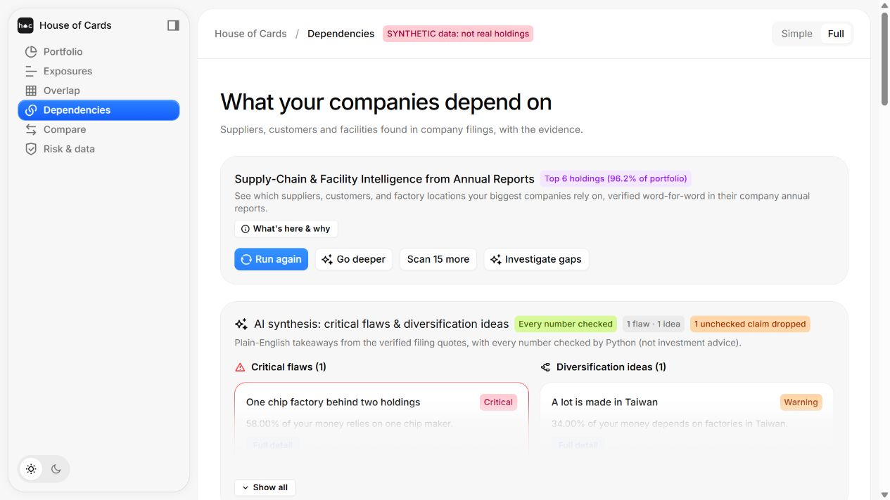
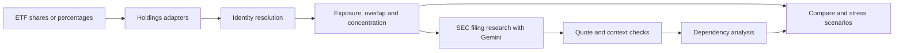

<div align="center">

<a href="https://house-of-cards-pink.vercel.app/"></a>

# House of Cards

**See what is really holding up your portfolio.**

Look through your ETFs to the companies you own, the dependencies they share, and the money at risk when one part fails.

<p>
  
  
  
  
</p>

**[Hosted demo](https://house-of-cards-pink.vercel.app/)** · **[Run locally](#quick-start)** · **[App tour](#a-tour-of-the-app)** · **[Evaluation](#evaluation)** · **[Docs](#documentation)**

</div>

> [!NOTE]
> The hosted deployment was paused when checked on 17 November 2026. [Run locally](#quick-start) to explore the app. The screenshots below use the app's labelled synthetic mode.

## Why House of Cards

Owning several ETFs does not necessarily mean owning several different risks. Funds can hold the same companies, and those companies can depend on the same supplier, factory location, or customer.

House of Cards connects **fund holdings → company exposure → disclosed dependencies → stress scenarios**. Start with your ETF mix, follow the evidence into SEC filings, and compare a different allocation before making any decisions.

<table>
<tr>
<td width="33%" valign="top"><h3>01 · Look through</h3>See your effective ownership in each company across all your funds. Share classes and supported cross-listings are merged.</td>
<td width="33%" valign="top"><h3>02 · Follow the evidence</h3>Explore suppliers, customers, and facilities extracted from annual reports, with word-for-word quote verification in Python.</td>
<td width="33%" valign="top"><h3>03 · Test a change</h3>Compare two ETF mixes and stress an industry, country, or supplier on the same dollar starting value.</td>
</tr>
</table>

## A tour of the app

Switch between **Simple view**, a five-step guided flow, and **Full view**, the analyst dashboard, while keeping your portfolio.

<table>
<tr>
<td width="50%" valign="top"><br><b>Start with your funds.</b> Enter shares or percentages, pin allocations, or load an example.</td>
<td width="50%" valign="top"><br><b>See what you actually own.</b> Search underlying companies and trace their contributions across funds.</td>
</tr>
<tr>
<td valign="top"><br><b>Spot duplicated exposure.</b> Inspect pairwise weighted overlap and the shared holdings behind it.</td>
<td valign="top"><br><b>Find shared dependencies.</b> Follow disclosed relationships and inspect the supporting filing quotes.</td>
</tr>
</table>

<sub>Actual app captures using <code>VITE_API_MOCK=1</code>. Holdings, prices, and filing evidence in these images are synthetic fixtures, not investment data.</sub>

| Screen | What you can explore |
|---|---|
| **Portfolio** | Share-count valuation at exchange closes, percentage allocations, pinned rows, and sample portfolios |
| **Exposures** | Effective company ownership, share-class merging, searchable holdings, and money-flow breakdowns |
| **Overlap** | Weighted ETF-pair heatmap and shared-company drilldowns |
| **Dependencies** | SEC 10-K / 20-F quotes, relationship importance, context checks, coverage, and bounded deeper research |
| **Compare / Try a change** | Side-by-side allocations, concentration deltas, change ideas, and industry/country/supplier failure scenarios |
| **Risk** | Top-5 / top-10 concentration, effective company count (1 / HHI), industries, countries, and disclosure dates |

## How it works

**Gemini proposes. Python calculates and verifies. You inspect the evidence.**



| Layer | Responsibility |
|---|---|
| **Holdings & identity** | TickerInside, iShares CSV, and SEC N-PORT adapters; CIK/LEI/ISIN identifiers and curated cross-listing aliases |
| **Deterministic maths** | Python computes exposure, weighted overlap, HHI, valuation, comparison deltas, and scenario losses |
| **Filing research** | Gemini proposes dependency quotes, judges ambiguous context, and performs bounded multi-step research |
| **Verification** | Python checks verbatim quotes and metric placeholders; context checks and importance scores accompany retained relationships |
| **Presentation** | FastAPI serves the React 19, TypeScript, Vite, and Tailwind v4 interface |

The [contract](docs/hoc/CONTRACT.md) specifies the calculations, schemas, and error codes. The [history](docs/hoc/HISTORY.md) covers the v1–v3.1 pipeline.

## Failure simulator

Ask **“What if one part fails?”** on Compare / Try a change. Pick an industry, country, or supplier to see the current and candidate portfolios under the same shock.

- **Historical proxy:** where price history is available, use the proxy ETF's worst 21-trading-day fall over five years of adjusted closes.
- **Explicit fallback:** when history is unavailable, use a simulated 20% fall and show the reason. Supplier shocks always use a simulated 20% fall.
- **Comparable dollars:** both portfolios use the shares-mode valuation total, or a notional $10,000 in percentage mode. The screen shows the shock basis and affected companies.

These are scenarios, not forecasts. Industry totals can use fund-reported sector breakdowns even when individual company sectors are incomplete. See the [scenario walkthrough](docs/hoc/demo/failure-simulator.md), [contract §11](docs/hoc/CONTRACT.md), and [standalone stress validation](validation/stress/).

## Evaluation

The recorded dependency benchmark covers **10 held-out non-tech SEC 10-K filings**, with **115 core relationships** and **79 hard negatives**, evaluated in replay mode. These are recorded results, not a fresh live-model run.

| Measure | Recorded result | Interpretation |
|---|---|---|
| **Blind precision** | **88.4%** · 114/129 | Initial blind annotation key |
| **Pooled precision** | **96.1%** · 124/129 | After adjudicating unmatched quotes; includes 10 accepted pooled relationships |
| **Core recall** | **57.4%** · 66/115 | Many disclosed relationships are still missed |
| **Hard negatives wrongly kept** | **1.3%** · 1/79 | One annotated negative retained |
| **Importance agreement** | **κ = 0.475** | Quadratic weighted agreement; importance remains imperfect |

The deeper research pass added **no new edges** on this benchmark. Supplier classification was a weak point, and facility-country lists contributed many recall misses. Read the [full evaluation](docs/hoc/EVAL.md) for confidence intervals, per-company results, pooling methodology, and error analysis.

## Quick start

**Prerequisites:** Python 3.12+ with [uv](https://docs.astral.sh/uv/), Node.js 22.12+, npm, and Git.

```bash
git clone https://github.com/yousuf-shahzad/house-of-cards.git
cd house-of-cards
```

### 1. Start the API

```bash
cd backend
uv sync
uv run uvicorn hoc.api.app:app --host 127.0.0.1 --port 8000
```

No secrets are needed for holdings analysis. For **uncached live SEC filing research**, copy [backend/.env.example](backend/.env.example) to `backend/.env`, fill in `HOC_SEC_CONTACT="Your Name you@example.com"` and `GEMINI_API_KEY`, then start with:

```bash
uv run --env-file .env uvicorn hoc.api.app:app --host 127.0.0.1 --port 8000
```

Keep real keys and personal contact details out of Git. Cached dependencies can be replayed without keys once a local cache exists; the cache is not included in a fresh clone.

### 2. Start the interface

In a second terminal, from the repository root:

```bash
cd frontend
npm ci
npm run dev
```

Open **[127.0.0.1:5173](http://127.0.0.1:5173)**. Vite proxies API requests to port 8000. The backend warms its local holdings cache on startup; first use needs data-provider network access.

<details>
<summary><b>Explore the UI with synthetic data and no backend</b></summary>

From `frontend/`, after `npm ci`:

```bash
VITE_API_MOCK=1 npm run dev
```

PowerShell:

```powershell
$env:VITE_API_MOCK = "1"
npm run dev
```

This mode shows a **SYNTHETIC** banner and uses committed fixtures. It demonstrates the interface; it does not fetch real holdings or call Gemini. Unset `VITE_API_MOCK` before returning to live mode.

</details>

<details>
<summary><b>Cache-only mode and command-line analysis</b></summary>

Run each command from `backend/`:

```bash
uv run python -m hoc.cli warm
uv run python -m hoc.cli analyse --example us-core-tilt
HOC_OFFLINE=1 uv run uvicorn hoc.api.app:app --host 127.0.0.1 --port 8000
```

In PowerShell, set `$env:HOC_OFFLINE = "1"` before the server command. Offline mode never fetches data; populate the cache first. Missing cache entries are reported rather than invented.

</details>

## Checks and validation

| Check | Working directory | Command |
|---|---|---|
| Backend unit & contract tests | `backend/` | `uv run pytest` |
| Recorded evaluation | `backend/` | `uv run hoc eval` |
| Portfolio validation | Repository root | `python validation/run_validation.py` |
| Stress validation | Repository root | `python validation/stress/run_stress_validation.py` |
| Frontend unit tests | `frontend/` | `node --test app/ui/*.test.mjs app/pages/**/*.test.mjs app/*.test.mjs` |
| Type check & production build | `frontend/` | `npm run build` |

Backend tests block network access; live-provider checks are separate. [Backend docs](backend/README.md) and [frontend docs](frontend/README.md) cover development in more detail.

## Data sources & licences

| Source | Used for | Licence & notes |
|---|---|---|
| [TickerInside](https://tickerinside.com/api/) | Primary ETF holdings, company names, exchange closes, CIK/FIGI identifiers | **CC BY 4.0.** Citation for each fund is displayed in the app. Republishes daily issuer files or quarterly SEC N-PORT filings. |
| [iShares](https://www.ishares.com) holdings CSV | Fallback for iShares funds, including GICS sectors | Fetched at runtime and cached locally; never redistributed. |
| [SEC EDGAR N-PORT](https://www.sec.gov/edgar) | Fallback holdings + ISIN and LEI identifiers | **Public domain.** Quarterly, published ~60 days after quarter end. |
| SEC EDGAR 10-K / 20-F & full-text search | Dependencies: suppliers, customers, facilities | **Public domain.** Requires `HOC_SEC_CONTACT`; rate-limited to $\le 10$ req/s. |
| Yahoo Finance v8 chart API | 5-year daily adjusted closes for sector/country proxy ETFs (`POST /api/stress`) | Fetched via 24h local cache; falls back to simulated `20%` drop when offline or unavailable. |
| Google Gemini API | Dependencies extraction (`Flash`), context judge, synthesis (`Argon`), change ideas | Requires `GEMINI_API_KEY`. Every quote and metric placeholder is verified in Python before display. |

No proprietary financial data is committed to this repository; the only committed fixtures are synthetic test cases (`backend/tests/fixtures/synthetic/`, `frontend/api/__fixtures__/`).

---

## Known limits

- **Holdings freshness:** Holdings are only as fresh as each fund's latest published disclosure (daily for issuer-backed funds; up to ~60 days after quarter end for N-PORT-only funds like `QQQ`).
- **Identity resolution:** Merges share classes through SEC `CIK`/`LEI` and a curated list of 48 cross-listing aliases (`TSM` ↔ `2330.TW`, Samsung common/preferred, Shell, Unilever). Cross-listings outside that list remain separate.
- **Company sectors:** Come from TickerInside's per-stock files for each fund's heaviest ~150 holdings; non-US local listings without a per-stock file show as `Unknown` at the company level while portfolio-level sector totals use each fund's reported breakdown.
- **Dependencies only see what companies disclose:** Big customers are often anonymous in filings (*"one customer accounted for 22% of revenue"* → flagged under `unnamed_customers`), annual reports can be up to a year old (`old_filings`), and broad macro-region facilities (*"Asia"*) remain unplaced (`region_only_facilities`) rather than assigned to a guessed country.
- **Cold dependency scan latency:** An uncached **Find dependencies** run reads ~15 annual reports and takes ~1–2 minutes; cached runs return immediately.
- **Exchange-close share valuation:** Share prices are exchange closes (not intraday NAV), and only USD-priced ETFs can be valued by shares; non-USD funds can be pinned to a `%` in Full view.
- **Not investment advice:** Local / demo proof of concept with no user accounts, no order execution, and no investment recommendations.

---

## Repository layout

| Path | Description |
|---|---|
| [`backend/`](backend/README.md) | FastAPI service (`hoc`): source adapters, normalisation, identity, portfolio & stress maths, SEC filing verifier, AI & research pipeline, CLI, and eval harness |
| [`frontend/`](frontend/README.md) | React + TypeScript + Vite UI (Simple walkthrough, 5-step Guide, and Full analyst view) |
| [`docs/hoc/`](docs/hoc/) | Architecture contract ([`CONTRACT.md`](docs/hoc/CONTRACT.md)), walkthrough ([`DEMO.md`](docs/hoc/DEMO.md)), failure-simulator demo table ([`demo/failure-simulator.md`](docs/hoc/demo/failure-simulator.md)), benchmark ([`EVAL.md`](docs/hoc/EVAL.md)), and version history ([`HISTORY.md`](docs/hoc/HISTORY.md)) |
| [`validation/`](validation/) | Standalone standard-library verification scripts (ETF overlap, residual return co-movement, and 5-year proxy ETF drawdowns in [`validation/stress/`](validation/stress/)) |
| [`scripts/`](scripts/) | Live API smoke checks ([`smoke_api.py`](scripts/smoke_api.py)) and TickerInside cross-checks |
| [`tools/board`](docs/AGENT_BOARD.md) | GitHub-issue message board CLI used by the human + multi-agent team |


## Documentation

| Start here | Go deeper |
|---|---|
| [Demo walkthrough](docs/hoc/DEMO.md) | [Mathematical & API contract](docs/hoc/CONTRACT.md) |
| [Failure-simulator examples](docs/hoc/demo/failure-simulator.md) | [Dependency benchmark & limitations](docs/hoc/EVAL.md) |
| [Backend development](backend/README.md) | [Version history](docs/hoc/HISTORY.md) |
| [Frontend development](frontend/README.md) | [Validation scripts](validation/) |

---

<p align="center"><b>Understand your exposure. Follow the evidence. Test the scenario.</b><br><sub>A portfolio research proof of concept. Not investment advice; no trading or order execution.</sub></p>
